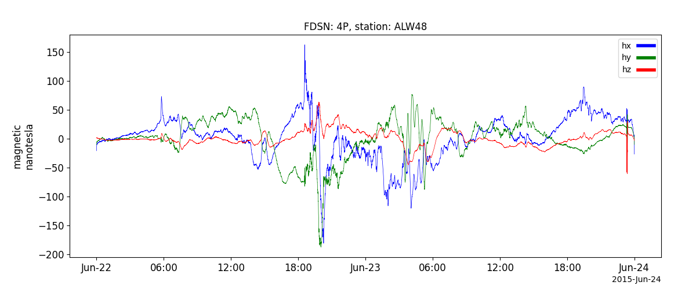
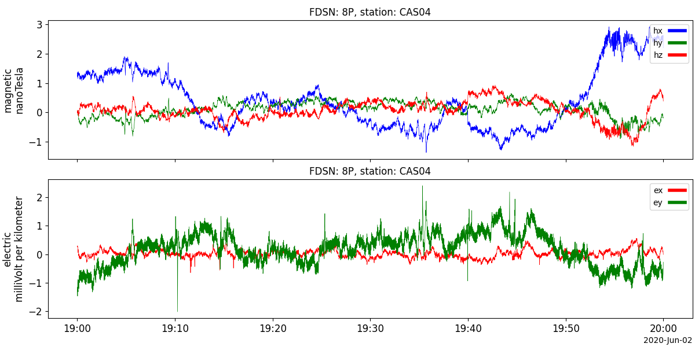

Magnetometer Data from Seismological Networks (mth5)
====================================================

This module converts the magnetometer data from the EarthScope `USArray magnetotelluric
<http://www.usarray.org/researchers/obs/magnetotelluric>`_ (MT) program using the `International Federation of Digital
Seismographic Networks <https://www.fdsn.org/networks/>`_ (FDSN) standards into high-level data products and provides
access to the data via PySPEDAS. It utilizes the `MTH5 <https://mth5.readthedocs.io/>`_ and `mt_metadata
<https://mt-metadata.readthedocs.io/>`_ packages that were developed at the USGS (U.S. Geological Survey).

Installation requirements
----------------------------------------------------------

The MTH5 package is not included as a default dependency in PySPEDAS. To use this module (`pyspedas.mth5`), please install MTH5:

.. code-block:: bash

   pip install mth5

This module downloads cache h5 files using the `EarthScope (formerly IRIS) Data Management Center
<http://service.iris.edu/fdsnws/dataselect/1/>`_, which provides FDSN-compliant access to a variety of information,
including data and metadata. Note that in 2023, Incorporated Research Institutions for Seismology (IRIS) became part of
the EarthScope Consortium, which explains the domain name of the data center. The cache files are stored in the `mth5`
folder, with the parent folder specified by the environment variable `SPEDAS_DATA_DIR`.

Load FDSN data
----------------------------------------------------------

To load data, the user must specify FDSN `network` and `station`. Currently, the module supports only magnetotelluric
data from MTArray. The stations can be explored using a browsable `Gmap <https://ds.iris.edu/gmap/>`_. Additional
examples are available via Jupyter notebooks of `PySPEDAS MTH5 examples
<https://github.com/spedas/pyspedas_examples/tree/master/pyspedas_examples/notebooks/mth5>`_ and a comprehensive guide
on `Accessing Magnetic Field Data from EarthScope Using MTH5
<https://github.com/simpeg/aurora/blob/main/docs/tutorials/earthscope_magnetic_data_tutorial.ipynb>`_.

.. important::

   **New: electric field support.** ``load_fdsn`` can now load the electric field (SEED instrument code ``Q``, MTH5
   components ``ex``/``ey``, calibrated to mV/km) in addition to the magnetic field (instrument code ``F``, components
   ``hx``/``hy``/``hz``, calibrated to nT). The new ``datatype`` keyword selects the field(s):

   * ``datatype='mag'`` (default): magnetic field, tplot variable ``fdsn_mag_<network>_<station>``.
   * ``datatype='elec'``: electric field, tplot variable ``fdsn_elec_<network>_<station>``.
   * ``datatype=['mag', 'elec']``: both fields.
   * ``datatype='legacy'``: magnetic field exactly as in earlier versions (see the warning below).

   Only the requested fields are downloaded. The ``.h5`` cache file name ends with the SEED instrument codes:
   ``..._F.h5``, ``..._Q.h5`` or ``..._FQ.h5``.

.. warning::

   **Behavior change.** In earlier versions, ``load_fdsn`` loaded the magnetic field into the tplot variable
   ``fdsn_<network>_<station>`` and returned that name as a string. Now the default (``datatype='mag'``) creates
   ``fdsn_mag_<network>_<station>`` and returns a **list** of tplot variable names.

   To keep the earlier behavior (variable names, string return value, and magnetic-only cache file), use
   ``datatype='legacy'``:

   .. code-block:: python

       load_fdsn(network="4P", station="ALW48", trange=['2015-06-22', '2015-06-24'], datatype='legacy')
       pyspedas.tplot('fdsn_4P_ALW48')

.. warning::

   An electric-only request (``datatype='elec'``) can fail in ``mth5=0.6.9`` and earlier when a station run has no
   electric channels in the requested period. A warning is logged; use ``datatype=['mag', 'elec']`` if it fails.

.. autofunction:: pyspedas.mth5.load_fdsn.load_fdsn

Example
^^^^^^^^^

Magnetic field example:

.. code-block:: python

    import pyspedas
    from pyspedas.mth5.load_fdsn import load_fdsn
    load_fdsn(network="4P", station="ALW48", trange=['2015-06-22', '2015-06-24'])
    pyspedas.tplot('fdsn_mag_4P_ALW48')

Magnetic and electric field example (station used in the `MTH5 magnetic and electric data tutorial
<https://github.com/simpeg/aurora/blob/main/docs/tutorials/earthscope_magnetic_and_electric_data_tutorial.ipynb>`_):

.. code-block:: python

    import pyspedas
    from pyspedas.mth5.load_fdsn import load_fdsn
    tvars = load_fdsn(network="8P", station="CAS04", trange=['2020-06-02T19:00:00', '2020-06-02T20:00:00'],
                      datatype=['mag', 'elec'])
    print(tvars)  # ['fdsn_mag_8P_CAS04', 'fdsn_elec_8P_CAS04']
    pyspedas.tplot(tvars)

Datasets availability
----------------------------------------------------------

.. important::

   **New:** ``datasets`` accepts the same ``datatype`` values as ``load_fdsn`` (``'mag'`` by default, ``'elec'``, or
   ``['mag', 'elec']``), plus ``keep_incomplete`` and ``quiet`` options; see the parameters below.

.. autofunction:: pyspedas.mth5.utilities.datasets

Example
^^^^^^^^^

Magnetic channels only (``datatype="mag"``, the default) printing output (``quiet=False``):

.. code-block:: python

   datasets(trange=["2020-06-02", "2020-06-03"], network="8P", station="CAS04",
                            datatype="mag", quiet=False)

.. code-block:: text

    8P CAS04
      Channels      Start                      End
      LFE,LFN,LFZ   2020-06-02T18:41:43.0000   2020-07-13T21:46:12.0000

Magnetic and electric channels (``datatype=["mag", "elec"]``):

.. code-block:: python

   from pyspedas.mth5.utilities import datasets
   results = datasets(trange=["2020-06-02", "2020-06-03"], network="8P", station="CAS04",
                            datatype=["mag", "elec"], keep_incomplete=True, quiet=False)

``quiet=False`` prints one row per time range, listing the channels that share it:

.. code-block:: text

    8P CAS04
      Channels      Start                      End
      LFE,LFN,LFZ   2020-06-02T18:41:43.0000   2020-07-13T21:46:12.0000
      LQE           2020-06-02T18:41:43.0000   2020-06-12T17:52:23.0000
      LQN           2020-06-02T18:41:43.0000   2020-07-01T17:32:59.0000

The electric channels ``LQE`` and ``LQN`` of this station end at different times, so they are not a complete set of channels over a common time range.
Without ``keep_incomplete=True`` they are removed, and only the magnetic channels are listed.
The returned dictionary ``results`` has the same content:

.. code-block:: text

    {'8P': {'CAS04': {('2020-06-02T18:41:43.0000', '2020-07-13T21:46:12.0000'): ['LFE', 'LFN', 'LFZ'],
                      ('2020-06-02T18:41:43.0000', '2020-06-12T17:52:23.0000'): ['LQE'],
                      ('2020-06-02T18:41:43.0000', '2020-07-01T17:32:59.0000'): ['LQN']}}}

