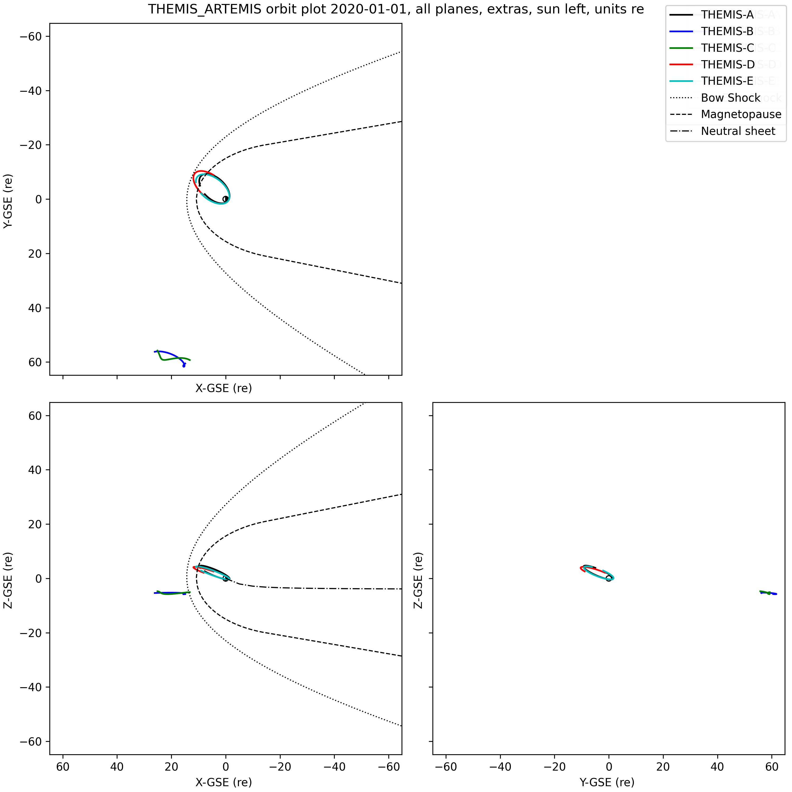

Plotting routines
=================

In past releases of PySPEDAS, plotting utilities, and many other tools that work with tplot variables, were
imported from the external pytplot-mpl-temp package.  As of PySPEDAS 2.0, they are now bundled with PySPEDAS.

Time-series plots: tplot
--------------------------

``tplot`` is the top level plotting routine.  It uses the matplotlib plotting library to render plots of tplot variables.
If multiple variables are plotted, they will be stacked vertically in the same Matplotlib figure, with their time
dimensions aligned (since they will all share an x-axis).

A large number of plot options are supported.  Some apply to the entire set of plots: for example,
the figure title, figure dimensions, background color, etc.  These global plot options are set
with the ``tplot_options`` routine, documented below.

Other plot options are associated with specific variables. These include plot colors, symbols,
legends, X, Y, and Z axis titles, and many more.  These are set with the ``options`` routine, documented below.

Since matplotlib is the underlying plot framework used by PySPEDAS, many of the global and per-variable
plot options accept the same options and argument conventions as matplotlib, although they may not
necessarily use the same names as Matplotlib.  (We often named the options after their IDL SPEDAS
counterparts, to make it easier on IDL users who are new to Python and Matplotlib.)

Therefore, when trying to fine tune the appearance of PySPEDAS plots, it may be useful to consult
the Matplotlib documentation at https://matplotlib.org/stable/ to see what options Matplotlib
accepts for color names, symbols, line styles, and other plot properties.

Formatting in titles and labels
^^^^^^^^^^^^^^^^^^^^^^^^^^^^^^^^^

Scientific plots often benefit from using mathematical formatting conventions, Greek letters, and symbols
in plot text. Matplotlib supports this with their ``mathtext`` markup language, which is their flavor
of Latex.  You can invoke 'mathtext' by enclosing your titles, subtitles, labels, etc. in ``$...$``
and using LaTex notation inside the ``$$`` delimiters.  For example, here's how to
indicate exponentiation, with a multiple-character superscript:

.. code-block:: python

    from pyspedas import options
    options(somevar,'ysubtitle',r"$\mathregular{nT^{-2}}$")

Breaking this notation down from the inside out:

``nT^{-1}`` is intended to render "nT" as the base and "-1" as the exponent.

``\mathregular{}`` renders its argument in a plain text font, without italicization or other
formatting.  This helps it blend in better with any surrounding text.

The ``$$`` delimiters indicate a mathtext expression.

``r""`` is the Python syntax for raw strings.  This prevents the ``\m`` in ``\mathregular`` from
being interpreted as a control character.

PySPEDAS has supported a nice rendering of superscript expressions like ``base^p`` in ``ysubtitle`` fields.
However, this only works for single-character exponents, and only in ``ysubtitle``.  We recommend
using the mathtext markup for mathematical notation instead of relying on this shortcut.

tplot API reference
^^^^^^^^^^^^^^^^^^^^^

.. autofunction:: pyspedas.tplot

``lineplot`` is a line plotting routine called by tplot. It is not usually called by users,
but is documented here for completeness.

.. autofunction:: pyspedas.lineplot

``specplot`` is a spectrogram plotting routine called by tplot. It is not usually called by users,
but is documented here for completeness.

.. autofunction:: pyspedas.specplot

tplot Per-Variable Plot Options
^^^^^^^^^^^^^^^^^^^^^^^^^^^^^^^^

.. autofunction:: pyspedas.options

.. autofunction:: pyspedas.timebar

.. autofunction:: pyspedas.databar

tplot "Global" plot options
^^^^^^^^^^^^^^^^^^^^^^^^^^^^^^

.. autofunction:: pyspedas.tplot_options

tplot Text annotations
^^^^^^^^^^^^^^^^^^^^^^^^

Use ``annotate`` to attach text to a tplot variable, then call ``tplot`` to draw
the updated panel. Names, zero-based variable indices, lists and wildcard
patterns are accepted. Non-time-varying variables are skipped with a warning.

By default, positions use ``xycoords="axes fraction"``: ``(0, 0)`` is the lower
left corner and ``(1, 1)`` is the upper right corner of the panel. This keeps
text in the same relative position when the plot limits change.

.. code-block:: python

    from pyspedas import annotate, store_data, tplot

    times = ["2024-01-01T00:00:00", "2024-01-01T00:01:00", "2024-01-01T00:02:00"]
    store_data("annotation_demo", data={"x": times, "y": [1, 2, 3]})
    annotate("annotation_demo", "Example", (0.05, 0.85))
    tplot("annotation_demo")

Annotations attached to a combined variable (pseudovariable) appear once on
its panel. Annotations attached to its component variables are also drawn.
For a panel with separate left and right y axes, annotations attached to the
combined variable use the left axis.

To tie the vertical position to a data value while keeping the horizontal
position relative to the panel, use ``xycoords=("axes fraction", "data")``.
Set ``annotation_clip=True`` to hide the label when its anchor position is
outside the axes, such as when zooming to a different y range.

.. code-block:: python

    store_data("annotation_other", data={"x": times, "y": [3, 2, 1]})
    store_data("annotation_pair", data=["annotation_demo", "annotation_other"])
    annotate("annotation_pair", "Combined panel", (0.05, 0.70))
    annotate("annotation_pair", "y = 2", (0.85, 2),
             xycoords=("axes fraction", "data"), annotation_clip=True)
    tplot("annotation_pair")

Repeated calls append annotations. ``delete=True`` removes all annotations
from each selected variable; to remove component annotations from a combined
plot, select those component variables as well. Call ``tplot`` again to show
the result:

.. code-block:: python

    annotate(["annotation_demo", "annotation_pair"], delete=True)
    tplot("annotation_pair")

Annotations are per-variable settings. Use ``annotate`` for normal use;
``options(name, "annotations", ...)`` replaces the annotations with a list of
annotation dictionaries in the format stored by ``annotate``. There is no
global ``tplot_options("annotations", ...)`` setting.

.. autofunction:: pyspedas.annotate

Time Windowing and Plot Limits
^^^^^^^^^^^^^^^^^^^^^^^^^^^^^^^^

.. autofunction:: pyspedas.tlimit
.. autofunction:: pyspedas.timespan
.. autofunction:: pyspedas.xlim
.. autofunction:: pyspedas.ylim
.. autofunction:: pyspedas.zlim

Interactive Time Selection from Plots
^^^^^^^^^^^^^^^^^^^^^^^^^^^^^^^^^^^^^^

The ctime routine is a close analogue of the IDL SPEDAS tool.  A call to tplot()
with return_plot_objects=True will return Matplotlib figure and axis objects that can
be passed to ctime.  During a call to ctime, a vertical time bar will track the cursor
location within the plot. Left-clicking will save that timestamp to the output list; after
selecting the desired number of points, the user can right-click to quit.  ctime will
then return the list of timestamps selected.

At the moment, ctime does not work reliably in a Jupyter notebook when the matplotlib 'ipympl'
backend is used, or with the default 'inline' non-interactive back end.  If you are developing a notebook which
calls ctime, we recommend specifying the 'auto' backend (via the 'magic' command "%matplotlib auto") before importing
or calling any pyspedas or matplotlib routines.

.. autofunction:: pyspedas.ctime

Non-time-series plots: orbits, field lines, and other 3-D vector data with tplotxy, tplotxy3
----------------------------------------------------------------------------------------------

PySPEDAS has the ability to generate certain kinds of non-time-series plots which involve projecting 3-D
position or field data onto one or more of the coordinate system planes.  Examples include orbit plots, field line traces,
or hodograms.

The ``tplotxy`` routine projects one or more 3-d input variables onto one of the 2D coordinate system planes:
xy, xz, or yz.

The ``tplotxy3`` routine projects and plots the input data onto all three coordinate planes in a single figure.
It also includes several features that are useful for orbit plots: once the initial figure is created,
one can add traces for bow shock, magnetopause boundaries, or neutral sheet locations by passing the
boundary data and the Matplotlib figure object to a helper routine to add the new traces.

.. autofunction:: pyspedas.tplotxy

.. autofunction:: pyspedas.tplotxy3

.. autofunction:: pyspedas.tplotxy3_add_mpause

.. autofunction:: pyspedas.tplotxy3_add_neutral_sheet

Changing projection ranges after plotting
^^^^^^^^^^^^^^^^^^^^^^^^^^^^^^^^^^^^^^^^^

``tplotxy`` and ``tplotxy3`` both return a Matplotlib figure with methods for changing its limits after
creation. Pass each range as a two-element sequence in the figure's ``plot_units``.
Give the lower and upper coordinate values in that order; the methods preserve the
plot's axis direction, including when ``reverse_x=True`` was used.

For ``tplotxy``, ``set_hrange`` and ``set_vrange`` control the horizontal and vertical
plot axes. These names apply to any projection: for example, the horizontal axis
of a YZ plot represents Y rather than X.

.. code-block:: python

    from pyspedas import tplotxy

    fig = tplotxy('tha_pos_gse', plane='yz', display=False)
    fig.set_hrange((-15, 15))  # Y on this projection
    fig.set_vrange((-10, 10))  # Z on this projection
    fig.show()

For ``tplotxy3``, ``set_xrange``, ``set_yrange``, and ``set_zrange`` refer to the
spatial coordinates. Each method updates both panels containing that coordinate:
X in XY and XZ, Y in XY and YZ, and Z in XZ and YZ.

.. code-block:: python

    from pyspedas import tplotxy3

    fig = tplotxy3('tha_pos_gse', reverse_x=True, display=False)
    fig.set_xrange((-15, 15))
    fig.set_yrange((-15, 15))
    fig.set_zrange((-10, 10))
    fig.show()

The corresponding ``hrange`` and ``vrange`` arguments to ``tplotxy``, and
``xrange``, ``yrange``, and ``zrange`` arguments to ``tplotxy3``, set the same
limits when creating the figure.

Example
^^^^^^^^^

This example displays THEMIS and ARTEMIS orbits using tplotxy3, then adds the bow shock, magnetopause, and AEN neutral sheet
location to the plots.

.. code-block:: python

        import pyspedas
        from pyspedas import tplotxy3, tplotxy3_add_mpause, tplotxy3_add_neutral_sheet
        from pyspedas.analysis.neutral_sheet import neutral_sheet
        from pyspedas import bshock_2, mpause_2, get_data, store_data, set_coords, set_units, cotrans
        import numpy as np

        # Load THEMIS state data
        default_trange = ["2020-01-01", "2020-01-02"]
        pyspedas.projects.themis.state(trange=default_trange, probe=['a','b','c','d','e'])
        # Calculate bow shock and magnetopause boundaries
        bs = bshock_2()
        mp = mpause_2()
        # The neutral sheet is a little more complicated, since it's time-dependent. We'll pick the midpoint
        # of the time interval
        d=get_data('tha_pos_gse')
        mid_time = (d.times[-1] - d.times[0])/2.0
        # Generate a set of points along the -X axis (night side of Earth), units of Re
        ns_x_re = -1.0*np.arange(0.0,375.0, 5.0)
        # We need replicate the timestamps to make a proper tplot variable
        times=np.zeros(len(ns_x_re))
        times[:] = mid_time
        ns_gsm_pos=np.zeros((len(ns_x_re),3))
        ns_gsm_pos[:,0] = ns_x_re
        # Generate the neutral sheet Z-axis values corresponding to the inputs
        ns = neutral_sheet(times, ns_gsm_pos, model="aen", sc2NS=False)
        # Add the Z component to the input positions, store it as a tplot variable
        ns_gsm_pos[:,2] = ns
        store_data('ns_gsm_pos', data={'x':times, 'y':ns_gsm_pos})
        # We're making a GSE plot, but the neutral sheet is generated in GSM, so we do a cotrans
        set_coords('ns_gsm_pos','GSM')
        set_units('ns_gsm_pos', 're')
        cotrans('ns_gsm_pos', 'ns_gse_pos',coord_in='gsm', coord_out='gse')
        # Finally, we have the neutral sheet Z positions along the X axis on the night side.
        gse_dat = get_data('ns_gse_pos')

        # Plot the orbits and capture the resulting figure
        fig = tplotxy3('th?_pos_gse',title='THEMIS_ARTEMIS orbit plot 2020-01-01, all planes, extras, sun left, units re', legend_names=['THEMIS-A','THEMIS-B', 'THEMIS-C', 'THEMIS-D', 'THEMIS-E'], reverse_x=True, plot_units='re', display=False)
        # Add bow shock to figure
        tplotxy3_add_mpause(bs[0],bs[1],fig=fig,legend_name="Bow Shock",color='k',linestyle='dotted',linewidth=1,display=False)
        # Add magnetopause to figure
        tplotxy3_add_mpause(mp[0],mp[1],fig=fig,legend_name="Magnetopause",color='k',linestyle='dashed',linewidth=1,display=False)
        # Add neutral sheet to figure, then display the plot, and save it to a file
        tplotxy3_add_neutral_sheet(gse_dat.y[:,0],gse_dat.y[:,2],fig=fig, legend_name="Neutral sheet",color='k',linestyle='dashdot',linewidth=1,display=True,save_png='orbits_thm_art_re_legends_extras_3planes.png')

Non-time-series plots: Maps and globes with Tplot_Map
-------------------------------------------------------

.. warning::

   **Experimental map API.** ``Tplot_Map``, its plotting methods and the
   ``tplot_map()`` entry point are experimental and have not been finalized.
   Parameters, return values and behavior may change, or these features may be
   removed, between releases without the standard deprecation period.
   Please share feedback on map creation, coordinate inputs and plotting options
   through the `PySPEDAS issue tracker
   <https://github.com/spedas/pyspedas/issues>`_ to help shape the stable API.

Use ``tplot_map()`` to create a map or globe and return a ``Tplot_Map`` object.
Its methods add paths, markers and circles around stations, using coordinate
arrays or tplot position variables. Map plotting requires the optional ``basemap``
package. Install it with the PySPEDAS ``maps`` extra:

.. code-block:: bash

    pip install "pyspedas[maps]"

Importing PySPEDAS works without basemap. Creating a map without it raises an
``ImportError`` with installation instructions.

Creating and decorating a map
^^^^^^^^^^^^^^^^^^^^^^^^^^^^^

``view`` selects a preset map center; ``projection`` and other Basemap keyword
arguments customize the projection. The returned object's ``ax`` and ``fig``
attributes expose its Matplotlib axes and figure. Map creation defaults to
``display=False``, so add overlays before calling ``show()``.

This example uses geodetic latitude/longitude pairs in degrees. Unlike the
``center=(longitude, latitude)`` argument to ``tplot_map()``, the default
``coord_type="geod_lat_lon"`` for the overlay methods expects latitude first.

.. code-block:: python

    import datetime as dt
    import numpy as np
    from pyspedas import tplot_map

    tmap = tplot_map(view="Northern Europe", land_color="lightgray",
                     water_color="lightblue")
    stations = np.array([[60.0, 15.0], [65.0, 20.0], [70.0, 25.0]])
    tmap.add_paths(stations, color="blue", linewidth=2)
    tmap.add_markers(stations, marker_size=30)
    tmap.add_nightshade(date=dt.datetime(2026, 1, 1, 12, 0))
    tmap.show()

.. figure:: _static/tplot_map_northern_europe.png
   :align: center
   :width: 640px
   :alt: Globe centered on northern Europe, with blue paths connecting red station markers and shading on the nighttime side of Earth.
   :class: imgborder

   Northern Europe with three station markers, a connecting path and nighttime
   shading for 1 January 2026 at 12:00 UTC.

``add_caps()`` draws circles around input coordinates, with their size set by
``fov_angle``. For tplot position variables, pass the variable name and choose
``coord_type`` to match its data (for example, ``"cart_GEO"`` for GEO Cartesian
positions). The method reference below describes the supported coordinate
formats, angle units and styling options.

The overlay methods accept either -180 to 180 or 0 to 360 degree longitudes.
On cylindrical maps, coordinates are wrapped to the longitude region selected
by the map bounds; on pseudocylindrical maps, they are wrapped around the central
meridian. Paths keep their original point order, and paths and circle edges are
split at map seams to avoid lines connecting opposite sides of the map.

The map initially draws coastlines, countries, filled continents, a map boundary,
meridians and parallels. Use ``option_dict`` and ``override_defaults`` to customize
these initial layers. ``print_map_options()`` displays the current settings.

Map API reference
^^^^^^^^^^^^^^^^^

.. autofunction:: pyspedas.tplot_map

.. autoclass:: pyspedas.tplot_tools.MPLPlotter.tplot_map.Tplot_Map

.. The class docstring already indexes its method summary. Avoid duplicate
   index entries when rendering the full method documentation below.

.. automethod:: pyspedas.tplot_tools.MPLPlotter.tplot_map.Tplot_Map.show
   :no-index:

.. automethod:: pyspedas.tplot_tools.MPLPlotter.tplot_map.Tplot_Map.print_map_options
   :no-index:

.. automethod:: pyspedas.tplot_tools.MPLPlotter.tplot_map.Tplot_Map.add_coastlines
   :no-index:

.. automethod:: pyspedas.tplot_tools.MPLPlotter.tplot_map.Tplot_Map.add_countries
   :no-index:

.. automethod:: pyspedas.tplot_tools.MPLPlotter.tplot_map.Tplot_Map.add_fillcontinents
   :no-index:

.. automethod:: pyspedas.tplot_tools.MPLPlotter.tplot_map.Tplot_Map.add_mapboundary
   :no-index:

.. automethod:: pyspedas.tplot_tools.MPLPlotter.tplot_map.Tplot_Map.add_meridians
   :no-index:

.. automethod:: pyspedas.tplot_tools.MPLPlotter.tplot_map.Tplot_Map.add_parallels
   :no-index:

.. automethod:: pyspedas.tplot_tools.MPLPlotter.tplot_map.Tplot_Map.add_nightshade
   :no-index:

.. automethod:: pyspedas.tplot_tools.MPLPlotter.tplot_map.Tplot_Map.add_paths
   :no-index:

.. automethod:: pyspedas.tplot_tools.MPLPlotter.tplot_map.Tplot_Map.add_markers
   :no-index:

.. automethod:: pyspedas.tplot_tools.MPLPlotter.tplot_map.Tplot_Map.add_caps
   :no-index:

.. autofunction:: pyspedas.convert_coords_to_geod_lonlat_list

