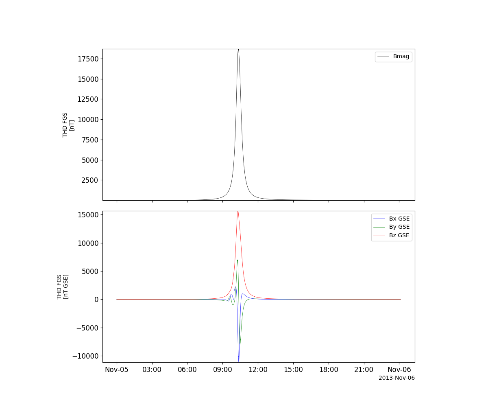
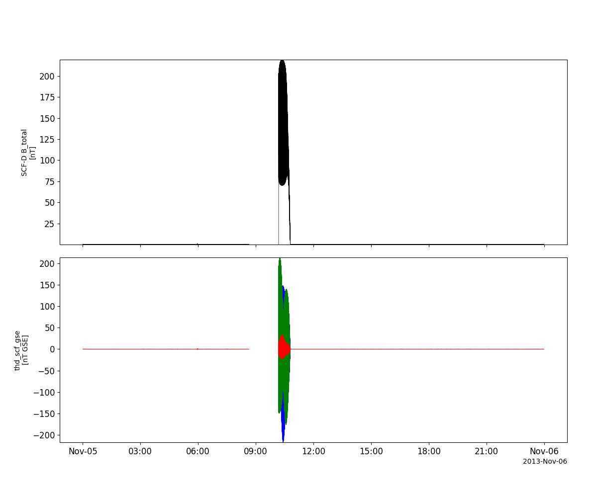
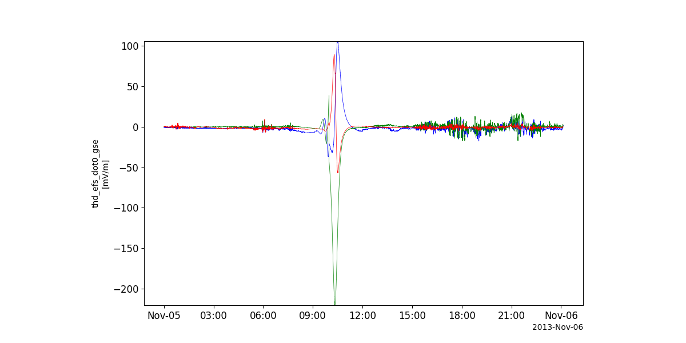
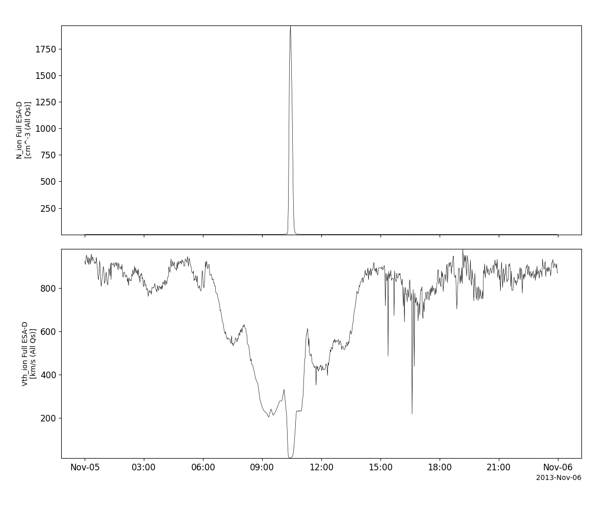
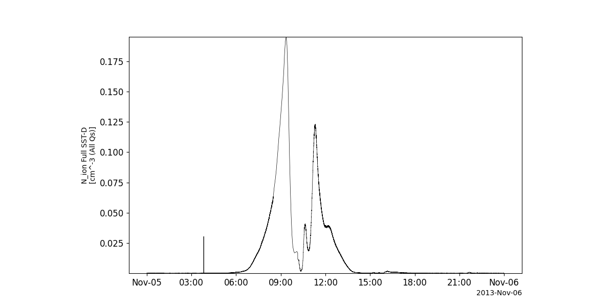
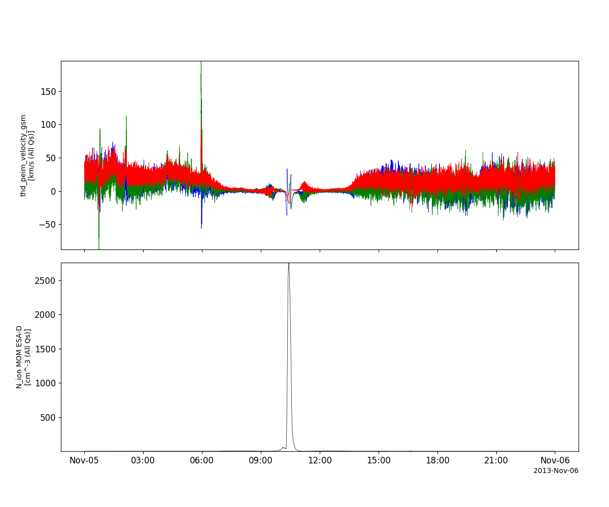
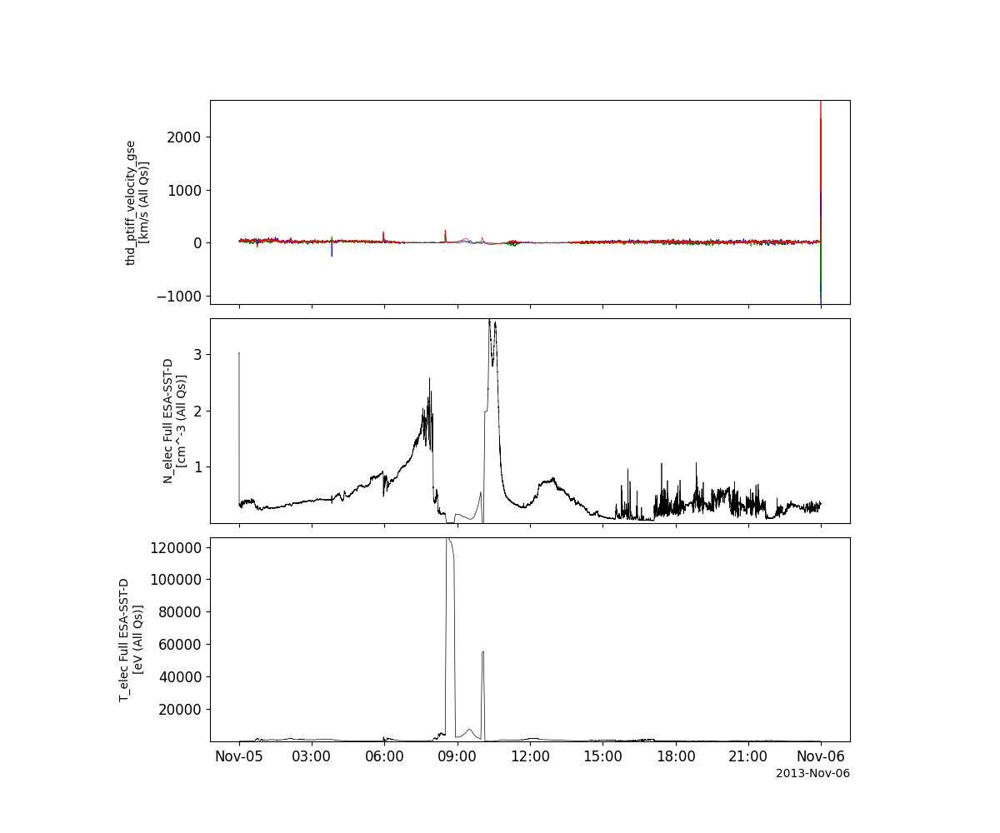
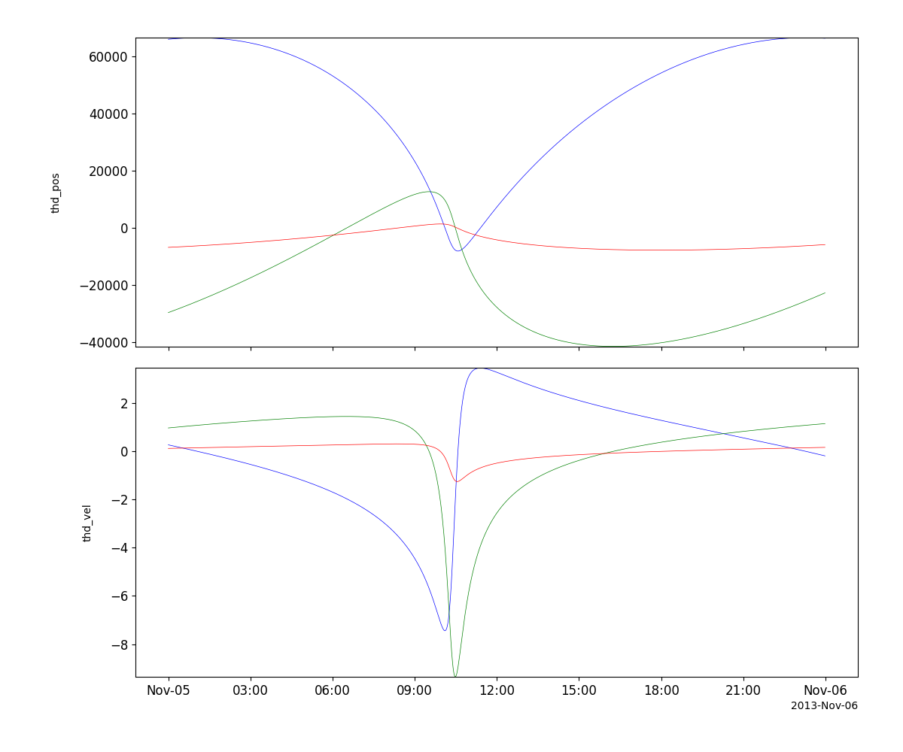
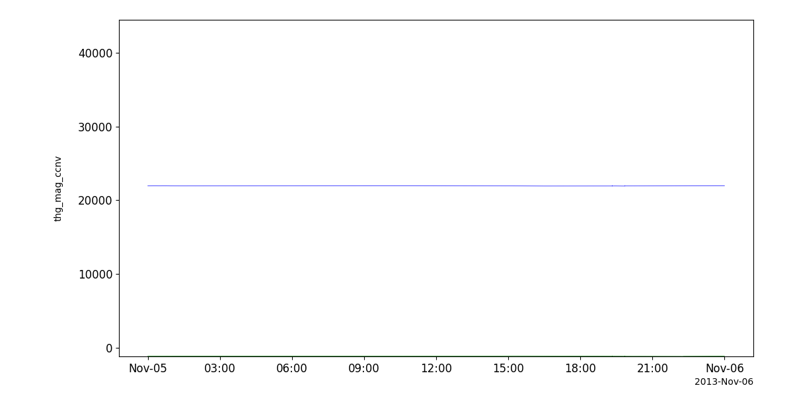

Time History of Events and Macroscale Interactions during Substorms (THEMIS)
==============================================================================
The routines in this module can be used to load data from the Time History of Events and Macroscale Interactions during Substorms (THEMIS) mission.

Provider shortcuts
------------------

.. warning::

   **Experimental source-routing API.** The provider setters/getters and new
   source-selection configuration interfaces have not been finalized. Their
   parameters, return values and behavior may change, or these features may be
   removed, between releases without the standard deprecation period.
   Please share feedback on configuration names, source selection and cache
   behavior through the `PySPEDAS issue tracker
   <https://github.com/spedas/pyspedas/issues>`_ to help shape the stable API.

Setters update in-memory ``CONFIG`` settings for the current session, log the
result at INFO level, and perform no network requests. Tags are case-sensitive.
An unsupported tag raises ``ValueError`` listing valid choices before any settings
change. Only the selected family's settings are updated.

Each setter has a matching ``get_..._source()`` function. Getters match the current
relevant configuration exactly, including direct ``CONFIG`` edits, and return a
provider tag or ``None`` for custom or incomplete settings. Direct URLs remain
supported. Setters do not save preferences; persistence remains an explicit step
through the existing preferences API.

.. list-table:: Supported presets
   :header-rows: 1

   * - Data family
     - Setter
     - Supported tags
   * - All satellite/ground data and GMAG metadata
     - ``set_data_source(source_tag)``
     - ``berkeley``, ``ucla``, ``spdf``, ``heliocloud``
   * - SSC orbit data
     - ``set_ssc_source(source_tag)``
     - ``spdf``

.. code-block:: python

    from pyspedas.projects.themis import config

    config.set_data_source('heliocloud')
    print(config.get_data_source())  # heliocloud

The main provider controls satellite data, all GMAG networks and station
metadata. Berkeley and UCLA use ``themis`` layout; SPDF and heliocloud use
``spdf`` layout. SSC retains its independent source.

.. autofunction:: pyspedas.projects.themis.config.set_data_source

.. autofunction:: pyspedas.projects.themis.config.get_data_source

.. autofunction:: pyspedas.projects.themis.config.set_ssc_source

.. autofunction:: pyspedas.projects.themis.config.get_ssc_source

Data sources and layouts
------------------------

Ordinary satellite and ground data use ``remote_data_dir`` and
``remote_data_layout`` in ``pyspedas.projects.themis.config.CONFIG``.
The THEMIS server and UCLA mirror use ``themis`` layout. SPDF and heliocloud
use ``spdf`` layout. Set the layout explicitly, independently of the hostname
or URL scheme. Existing SPDF/S3 configurations must set it to ``spdf``.

All GMAG networks, including variometers, use the main URL/layout pair.
Mission URLs name roots containing ``tha/``, ``thg/``, etc. Station metadata is
read from ``thg/gmags_meta.csv`` beneath ``remote_data_dir`` and cached at that
relative path beneath ``local_data_dir``. S3 metadata is copied locally for
offline use. ``gmag(no_update=True)`` and ``CONFIG['no_download']`` suppress
metadata downloads as well as CDF downloads. Unavailable metadata raises
``FileNotFoundError``. Changing the main URL or cache root invalidates the
in-memory metadata table on the next lookup.

``ssc_remote_data_dir`` independently controls definitive and predicted SSC
orbit data, retaining its existing CDAWeb root and path conventions. For example:

.. code-block:: python

    from pyspedas.projects.themis import config

    config.set_data_source('heliocloud')  # Includes GMAG data and metadata
    config.set_ssc_source('spdf')

Heliocloud holdings are being synchronized with SPDF; missing files may remain
unavailable until ingest/backfilling completes. Requests do not fall back to
another provider. Select ``spdf`` or another provider explicitly when needed.
Cache paths follow server layouts; existing files are not moved.

The three source settings accept stored preferences under ``[projects.themis]``
and matching ``THM_REMOTE_DATA_DIR``, ``THM_REMOTE_DATA_LAYOUT``, and
``THM_SSC_REMOTE_DATA_DIR`` environment overrides.

State version selection is unchanged. With no explicit version, ``themis`` uses
the unversioned current-file link; ``spdf`` wildcards the version and selects the
highest available. An explicit version requests that exact file, which may be
absent from the server. Other instrument version defaults remain unchanged.

Fluxgate magnetometer (FGM)
----------------------------------------------------------
.. autofunction:: pyspedas.projects.themis.fgm

Example
^^^^^^^^^

.. code-block:: python
   
   import pyspedas
   from pyspedas import tplot
   fgm_vars = pyspedas.projects.themis.fgm(probe='d', trange=['2013-11-5', '2013-11-6'])
   tplot(['thd_fgs_btotal', 'thd_fgs_gse'])

Search-coil magnetometer (SCM)
----------------------------------------------------------
.. autofunction:: pyspedas.projects.themis.scm

Example
^^^^^^^^^

.. code-block:: python
   
   import pyspedas
   from pyspedas import tplot
   scm_vars = pyspedas.projects.themis.scm(probe='d', trange=['2013-11-5', '2013-11-6'])
   tplot(['thd_scf_btotal', 'thd_scf_gse'])

Electric Field Instrument (EFI)
----------------------------------------------------------
.. autofunction:: pyspedas.projects.themis.efi

Example
^^^^^^^^^

.. code-block:: python
   
   import pyspedas
   from pyspedas import tplot
   efi_vars = pyspedas.projects.themis.efi(probe='d', trange=['2013-11-5', '2013-11-6'])
   tplot('thd_efs_dot0_gse')

Electrostatic Analyzer (ESA)
----------------------------------------------------------
.. autofunction:: pyspedas.projects.themis.esa

Example
^^^^^^^^^

.. code-block:: python
   
   import pyspedas
   from pyspedas import tplot
   esa_vars = pyspedas.projects.themis.esa(probe='d', trange=['2013-11-5', '2013-11-6'])
   tplot(['thd_peif_density', 'thd_peif_vthermal'])

Solid State Telescope (SST)
----------------------------------------------------------
.. autofunction:: pyspedas.projects.themis.sst

Example
^^^^^^^^^

.. code-block:: python
   
   import pyspedas
   from pyspedas import tplot
   sst_vars = pyspedas.projects.themis.sst(probe='d', trange=['2013-11-5', '2013-11-6'])
   tplot('thd_psif_density')

Onboard Filter Bank Data (FBK)
------------------------------

.. autofunction:: pyspedas.projects.themis.fbk

Onboard FFT Data (FFT)
-----------------------

.. autofunction:: pyspedas.projects.themis.fft

Onboard Moments Data (MOM)
---------------------------

.. autofunction:: pyspedas.projects.themis.mom

Example
^^^^^^^^^

.. code-block:: python
   
   import pyspedas
   from pyspedas import tplot
   mom_vars = pyspedas.projects.themis.mom(probe='d', trange=['2013-11-5', '2013-11-6'])
   tplot(['thd_peim_velocity_gsm', 'thd_peim_density'])

Ground computed moments data (GMOM)
----------------------------------------------------------
.. autofunction:: pyspedas.projects.themis.gmom

Example
^^^^^^^^^

.. code-block:: python
   
   import pyspedas
   from pyspedas import tplot
   gmom_vars = pyspedas.projects.themis.gmom(probe='d', trange=['2013-11-5', '2013-11-6'])
   tplot(['thd_ptiff_velocity_gse', 'thd_pteff_density', 'thd_pteff_avgtemp'])

State data (STATE)
----------------------------------------------------------

.. autofunction:: pyspedas.projects.themis.state

Example
^^^^^^^^^

.. code-block:: python
   
   import pyspedas
   from pyspedas import tplot
   state_vars = pyspedas.projects.themis.state(probe='d', trange=['2013-11-5', '2013-11-6'])
   tplot(['thd_pos', 'thd_vel'])

Orbit data from SSCWeb (SSC)
----------------------------------------------------------

.. autofunction:: pyspedas.projects.themis.ssc

Example
^^^^^^^^^

.. code-block:: python
   
   from pyspedas.projects.themis import ssc
   ssc_vars = ssc(probe='d', trange=['2012-10-01', '2012-10-02'])
   print(ssc_vars)

   ['GEO_LAT', 'GEO_LON', 'GEO_LCT_T', 'GM_LAT', 'GM_LON', 'GM_LCT_T', 'GSE_LAT', 'GSE_LON', 'GSE_LCT_T', 'GSM_LAT', 'GSM_LON', 'SM_LAT', 'SM_LON', 'SM_LCT_T', 'NorthBtrace_GEO_LAT', 'NorthBtrace_GEO_LON', 'NorthBtrace_GEO_ARCLEN', 'SouthBtrace_GEO_LAT', 'SouthBtrace_GEO_LON', 'SouthBtrace_GEO_ARCLEN', 'NorthBtrace_GM_LAT', 'NorthBtrace_GM_LON', 'NorthBtrace_GM_ARCLEN', 'SouthBtrace_GM_LAT', 'SouthBtrace_GM_LON', 'SouthBtrace_GM_ARCLEN', 'RADIUS', 'MAG_STRTH', 'DNEUTS', 'BOW_SHOCK', 'MAG_PAUSE', 'L_VALUE', 'INVAR_LAT', 'MAG_X', 'MAG_Y', 'MAG_Z', 'XYZ_GEO', 'XYZ_GM', 'XYZ_GSE', 'XYZ_GSM', 'XYZ_SM']

Orbit predictions from SSCWeb (SSC_PRE)
----------------------------------------------------------

.. autofunction:: pyspedas.projects.themis.ssc_pre

Example
^^^^^^^^^

.. code-block:: python
   
   from pyspedas.projects.themis import ssc_pre
   ssc_pre_vars = ssc_pre(probe='a', trange=['2028-12-01', '2028-12-02'])
   print(ssc_pre_vars)

   ['GEO_LAT', 'GEO_LON', 'GEO_LCT_T', 'GM_LAT', 'GM_LON', 'GM_LCT_T', 'GSE_LAT', 'GSE_LON', 'GSE_LCT_T', 'GSM_LAT', 'GSM_LON', 'SM_LAT', 'SM_LON', 'SM_LCT_T', 'NorthBtrace_GEO_LAT', 'NorthBtrace_GEO_LON', 'NorthBtrace_GEO_ARCLEN', 'SouthBtrace_GEO_LAT', 'SouthBtrace_GEO_LON', 'SouthBtrace_GEO_ARCLEN', 'NorthBtrace_GM_LAT', 'NorthBtrace_GM_LON', 'NorthBtrace_GM_ARCLEN', 'SouthBtrace_GM_LAT', 'SouthBtrace_GM_LON', 'SouthBtrace_GM_ARCLEN', 'RADIUS', 'MAG_STRTH', 'DNEUTS', 'BOW_SHOCK', 'MAG_PAUSE', 'L_VALUE', 'INVAR_LAT', 'MAG_X', 'MAG_Y', 'MAG_Z', 'XYZ_GEO', 'XYZ_GM', 'XYZ_GSE', 'XYZ_GSM', 'XYZ_SM']

Ground Magnetometer Data (GMAG)
----------------------------------------------------------

.. autofunction:: pyspedas.projects.themis.gmag

Example
^^^^^^^^^

.. code-block:: python
   
   import pyspedas
   from pyspedas import tplot
   gmag_vars = pyspedas.projects.themis.gmag(sites='ccnv', trange=['2013-11-5', '2013-11-6'])
   tplot('thg_mag_ccnv')

